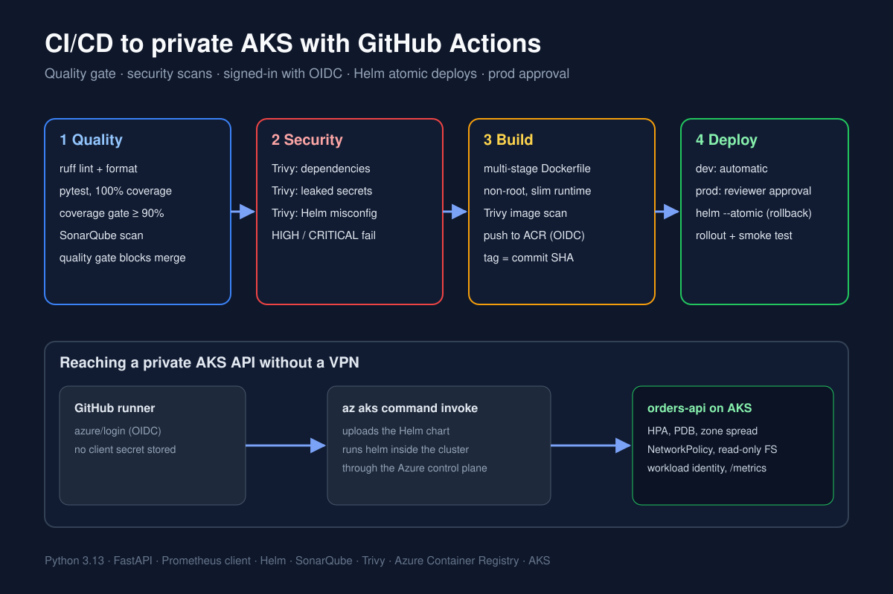

# CI/CD to a private AKS cluster with GitHub Actions

A complete delivery pipeline for a containerised Python service: tests and a SonarQube quality gate, security scanning with Trivy, an image pushed to Azure Container Registry, and Helm deployments to a **private** AKS cluster with a manual approval before production. The pipeline signs in to Azure with OIDC, so there are no stored cloud secrets.



## The service

`app/` holds **orders-api**, a small FastAPI service with:

- CRUD endpoints for orders, with input validation
- `/healthz` and `/readyz` probes for Kubernetes
- `/metrics` with request count and latency histograms per route, for Prometheus
- 8 tests at 100% coverage; the build fails below 90%

```bash
cd app
pip install -e ".[dev]"
pytest
uvicorn orders_api.main:app --reload
```

## Pipeline stages

| Stage | What runs | Fails the build when |
|---|---|---|
| Quality | `ruff` lint and format, `pytest` with coverage | lint errors, failing tests, coverage under 90% |
| SonarQube | scan + quality gate | the quality gate fails (bugs, smells, duplication, coverage on new code) |
| Security | Trivy on dependencies, secrets and Helm misconfiguration | any fixable HIGH or CRITICAL finding |
| Build | multi-stage image, Trivy image scan, push to ACR tagged with the commit SHA | the image has fixable HIGH or CRITICAL CVEs |
| Deploy dev | Helm upgrade with `--atomic`, rollout check, smoke test | the rollout or smoke test fails (Helm rolls back) |
| Deploy prod | same as dev, after a reviewer approves the `prod` environment | as above |

## Deploying to a private cluster

GitHub-hosted runners cannot reach a private AKS API server. Instead of a self-hosted runner or VPN, the deploy job uses `az aks command invoke`: it uploads the Helm chart and runs `helm` inside the cluster through the Azure control plane. See [.github/workflows/deploy.yml](.github/workflows/deploy.yml).

## Kubernetes hardening in the chart

- runs as a non-root user with a read-only root filesystem, all capabilities dropped and the RuntimeDefault seccomp profile
- HPA on CPU, PodDisruptionBudget, pods spread across zones
- zero-downtime rolling updates (`maxUnavailable: 0`)
- NetworkPolicy that only admits the ingress controller and Prometheus
- optional workload identity, Ingress (AKS app routing) and ServiceMonitor
- per-environment values in `values-dev.yaml` and `values-prod.yaml`

## Setup

Repository variables:

| Variable | Purpose |
|---|---|
| `AZURE_CLIENT_ID`, `AZURE_TENANT_ID`, `AZURE_SUBSCRIPTION_ID` | OIDC sign-in (federated credential on an Entra ID app) |
| `ACR_LOGIN_SERVER` | for example `myregistry.azurecr.io` |
| `AKS_RESOURCE_GROUP`, `AKS_CLUSTER_NAME` | deploy target |
| `APP_IDENTITY_CLIENT_ID` | optional workload identity for the pod |
| `SONAR_HOST_URL` | SonarQube server; secret `SONAR_TOKEN` holds the token |

Create `dev` and `prod` environments in the repository settings and add required reviewers to `prod`.

Without these variables the pipeline still runs the quality, security and build stages, so forks and pull requests stay green.

The cluster, registry and network this deploys to are built in [azure-landing-zone-terraform](https://github.com/abdoelwaly/azure-landing-zone-terraform).
